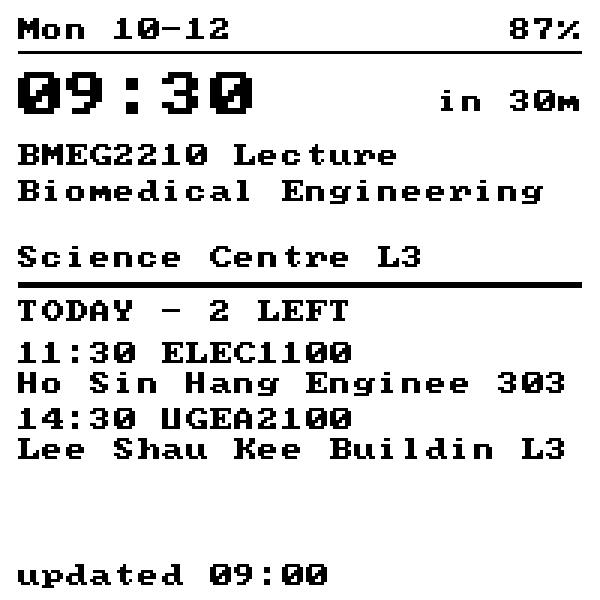

# 硬件：把课表放进口袋的墨水屏牌

一句话：一块 1.54 寸墨水屏，显示「下一节课几点、上什么、在哪栋楼、今天还剩几节」，
数据来自 olympicprotocol.com 那套课表代理，电池能撑几个月。

## 现在到哪一步了

| 部分 | 状态 | 在哪儿 |
| --- | --- | --- |
| 设备取数接口（手表要的那一小包数据） | 写好，41 条单测盯着 | `worker/device-payload.js`、`worker/timetable-proxy.js` |
| 固件（联网 → 解析 → 画屏 → 深度睡眠） | 写好，**没上过真机** | `hardware/firmware/` |
| 屏幕排版预览（电脑上看真机会画成什么样） | 写好，5 种画面可看 | `hardware/preview/` |
| 到货第一天清单（从零到第一屏） | 板子到了就照它走 | `hardware/BRINGUP.md` |
| 实物板子 | 已到货 | 见下面采购清单 |

没有实物的情况下，能验的都验了：接口逻辑跑单测，排版用固件里**同一份**字库和
排版参数在电脑上画成 PNG，连"有没有画出界"都是脚本在查（`--check`）。
买回来之后要做的第一件事是烧固件、看屏幕——见「上电与刷机」。

## 为什么是这块板子

参考的那次讨论（ESP32 → 手表 → 从网站拉课表）最后落到 **ESP32-C6**，理由是低功耗：

- **C6**：RISC-V 单核 160MHz，深度睡眠电流官方 35µA 上下，实测做墨水屏项目能压到 10µA 级；
- **S3**：双核 240MHz，算力用不上；深度睡眠 100–240µA，**带 PSRAM 的版本待机能到 5mA**
  ——对小电池设备是灾难。

具体买哪块，比过三种：

| 方案 | 花销 | 说明 |
| --- | --- | --- |
| **微雪 ESP32-C6-ePaper-1.54**（本目录选的就是它） | **$16.99** | 板载 1.54″ 200×200 墨水屏、PCF85063 实时时钟、SHTC3 温湿度、ES8311 音频、16MB Flash、锂电充电管理、2×6 排针。**开箱即用，不用焊** |
| Watchy 套件 | $65–80 | 手表形态的完整套件，但要焊、要 3D 打印外壳，屏幕更小 |
| LightInk 那类自制 | $70 起 | 续航最猛（月级），但要求自己画板、打样、焊 QFN、写电源管理，工具门槛高 |

选第一块的原因很实际：**先让"从网站拉到课、显示在墨水屏上"这件事跑通**，
形态（手表？桌牌？书包挂牌？）以后再说。板子本身已经把最难的电源管理和屏幕
都做好了。

## 采购清单

### 必买

| 东西 | 型号 / 规格 | 参考价 | 在哪买 |
| --- | --- | --- | --- |
| 主板（含屏） | 微雪 **ESP32-C6-ePaper-1.54**（SKU 34393，含电池版） | **$16.99（约 ¥120）** | 微雪官网 / 淘宝「微雪电子」 |
| 主板（不含电池） | 同上 `-EN` 版（SKU 34394） | $17.99 | 已经有 3.7V 锂电就买这版 |
| 锂电池 | 3.7V 锂聚合物，**MX1.25 2PIN 插头**，500–1000mAh | ¥15–30 | 淘宝（搜「3.7V 锂电池 MX1.25」） |
| Type-C 数据线 | 能传数据的（不是只充电的） | ¥10 | 家里多半有 |

> 锂电池插头是 **MX1.25 2PIN**，买错插不进去。板子自带充电管理，
> 插 USB 就充，不用额外买充电模块。

### 想省事可以再买

| 东西 | 干什么用 | 参考价 |
| --- | --- | --- |
| USB 转 TTL 串口模块 | 万一 USB 口刷不进去时兜底；也能直接看串口日志 | ¥10–20 |
| 3D 打印外壳 / 亚克力支架 | 当桌牌用；官方给了结构图，可以按图自己画 | ¥0–50 |
| 2.54mm 排线、杜邦线 | 从 2×6 排针引电、接传感器 | ¥10 |

### 不需要买（这块板子已经有了）

屏幕驱动电路、充电管理、实时时钟、温湿度传感器、Flash、按键——都不用另配。

> 说明：板子价格是 2026-10 微雪官网的实价；电池和配件是淘宝常见价位，只作预算参考。

## 硬件事实（照抄官方仓库，没有猜）

引脚来自 `waveshareteam/ESP32-C6-ePaper-1.54` 官方仓库里的
`02_Example/arduino_v3.3.0/07_BATT_PWR_Test/epaper_config.h`：

| 作用 | 引脚 |
| --- | --- |
| 墨水屏 SPI：SCK / MOSI / MISO / CS / DC / RST / BUSY | GPIO6 / 5 / 4 / 7 / 15 / 11 / 10 |
| I2C：SDA / SCL（400kHz） | GPIO18 / GPIO8 |
| I/O 扩展芯片 TCA9554 | 地址 `0x20` |
| 实时时钟 PCF85063 | 地址 `0x51` |
| 按键 PWR / BOOT | GPIO2 / GPIO9 |
| 电池电压采样 | GPIO0（ADC1 通道 0），分压 ÷2 |

**两条反直觉、但不知道就会卡住的事**：

1. **屏幕的电不归 GPIO 管**。墨水屏那一路供电挂在 TCA9554 的第 0 位上
   （音频是第 1 位）。上电后不先把这位拉高，屏幕就是不亮——不是接线问题。
2. **关机也是 TCA9554 的一位**（第 5 位，电源保持线）。官方示例里"长按 PWR 关机"
   就是把这位拉低，板子自己断电。电池分压的使能也在这条链上。

还有一条：**墨水屏和 TF 卡共用同一组 SPI**，本项目不用 TF 卡，所以不用管。

## 数据怎么从网站到手表的

```
墨水屏牌 ──POST {学号, 密码}──▶ Cloudflare Worker（/d/<设备口令>）
                                      │
                                      ├─▶ 转发一次到港中大课表接口（见 worker/README.md）
                                      └─▶ 压成一小包「今天 / 接下来」（≤4096 字节）
墨水屏牌 ◀──────────── 小包 JSON ─────┘
```

为什么不让手表直接读网页那份数据：网页那份是 28 字段的原始行，一天几十条、
体积大，手表每次醒来只有十几秒和一点点电。压小这一步放在 Worker 上，
手表只做「解析 → 画」。压缩规则和几条约定都写在 `worker/README.md`。

**关于密码**：板子把学号和密码存在自己的 Flash 里（`include/config.h`，不进 Git），
每次醒来都要发给 Worker 去登学校系统。这是最直接的方案，代价是"密码在设备里"。
想避免的话有个干净的升级路径：让 Worker 把课表**缓存**起来（KV 或 Cache API），
网页上登一次、点一下"同步到手表"，之后手表只凭设备口令读快照，自己不再拿密码。
代码结构已经留好了位置（`Net::fetch` 换个地址即可）。

## 屏幕长什么样

预览图在 `hardware/preview/out/`，用 `node hardware/preview/render.mjs` 生成。

| 画面 | 什么时候出现 |
| --- | --- |
| `01-monday-morning.png` | 周一早上，下一节还有 30 分钟 |
| `02-in-class.png` | 正在上课（大字改成 NOW） |
| `03-tomorrow.png` | 今天没课了，显示明天的课 |
| `04-no-classes.png` | 这学期还没导入课表 |
| `05-offline.png` | 连不上网，显示上次的结果并在页脚标 OFFLINE |



排版上有几条是硬约束，改的时候要一起想：

- 一行 **23 个字符**（200px 宽、8px 一个字、左右各留 6px 边距）；
- 字库是 **8×8 点阵、只覆盖 ASCII 32–126**。所以课名/地名里的**中文会显示成 `?`**
  （一个汉字三字节 → 三个 `?`）。老师名、课名基本是英文，够用；要显示中文得
  另外做一套中文字库子集，见「下一步」；
- 一屏信息分四段：顶部日期+电量 / 中间下一节（大字时间 + 那节课的地点）/
  下面一段列表 / 页脚更新时间。课少时列表每节占两行（多一行地点），
  课多时退回一行一节，能多列几节。

## 续航估算

按"每天醒来 6 次"算（每天 07:00 一次 + 每节课提前 15 分钟 + 开课/下课各一次）：

| 项目 | 估算 | 说明 |
| --- | --- | --- |
| 深度睡眠 | ≈40 µA（≈1.0 mAh/天） | C6 深睡 + RTC + I/O 扩展芯片 + 分压电路 |
| 每次醒来 | ≈0.4 mAh | 连 WiFi ~4s、请求学校系统 5–20s、刷屏 2s，合计约 10–25s @ 90mA |
| 每天合计 | ≈3.4 mAh | 1.0 + 6×0.4 |
| **500mAh 电池** | **≈5 个月** | |
| **1000mAh 电池** | **≈10 个月** | |

注意最大的一笔开销不是屏幕，是**每次醒来都要重新登一遍学校系统**（十几秒）。
把课表缓存在 Worker 上、让手表只读快照，单次唤醒能砍到 5 秒内，
续航大致能再翻一倍——这是性价比最高的一步优化。

（以上是纸面估算，误差主要来自 WiFi 握手时间和上游响应时间。真机第一次跑起来
后，用串口日志里的实际耗时把这张表改准。）

## 上电与刷机

按 **[BRINGUP.md](BRINGUP.md)** 那份清单走，每一步都写了「怎么算这步成功了」：

0. **先在电脑上验通接口**（`node hardware/tools/check-endpoint.mjs <地址>`）——
   这一步不碰板子，能把地址/口令/账号这三样一次验掉；
1. 装 VS Code + PlatformIO；
2. 把 `include/config.example.h` 复制成 `include/config.h` 填四个值；
3. 按住 BOOT 插 Type-C 进下载模式；
4. Upload，然后开串口监视器看第一屏（预期画面和失败怎么查都写在清单里）。

排错表在 `hardware/firmware/README.md`。

## 已知的坑

- **中文显示成 `?`**：字库只有 ASCII。要中文得做字库子集（见下）。
- **不知道学校放假**：Worker 那侧还没接校历（`data/holidays.js` 里有），
  放假当天会照课表显示。
- **设备地址要手填**：现在得手工把 `/d/<口令>` 抄进 `config.h`；以后应该在网页上
  加一张"设备"卡片，显示地址和二维码。
- **网页有、手表没有**：手表只保留接下来 7 天、并且按起止日期筛过。用网页那条地址跑
  `node hardware/tools/check-endpoint.mjs <网页地址>`，它会逐行告诉你哪一行被什么原因
  挡掉（过期、时间认不出、超过 4096 字节被裁……）。
- **USB 供电时电量不准**：那时读的是充电电压，会显示 100%。看电量要看拔线后的值。
- **不校验证书**（`client.setInsecure()`）：板子第一次上电没有可信时间做校验。
  讲究的话把 Cloudflare 的根证书贴进固件。
- **每天固定 07:00 醒来**这个锚点写死在 `main.cpp`，要改时间就改 `planSleepMinutes`。

## 下一步可以做什么

1. **真机跑通**（第一优先）：买板子 → 烧固件 → 把续航和屏幕效果测准。
2. **Worker 缓存课表**：手表不再带密码，唤醒时间砍半，续航翻倍。
3. **中文字库子集**：从网页现有的中文串里挑出用得到的字，生成点阵塞进固件。
4. **网页上的"设备"卡片**：显示设备地址（含口令的二维码）+ 一键"把课表推到手表"。
5. **校历接入**：放假当天显示"今天放假"，而不是课表。
6. **形态**：换个外壳当桌牌，或者上手表带；屏幕和固件都不用动。
